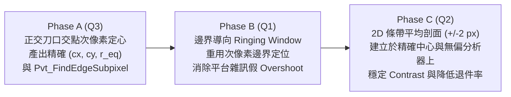

# PVT 靶標精密量測與次像素定心架構書 v1.0

> 專案：`C:\Github\roi-analyzer`（純 C ＋ Win32 ＋ GDI ＋ WIC，ANSI 全 A 版，`-Wall -Wextra` 零警告，C11）
> 父文件：`docs/pvt_target_architecture.md`（v1.5）
> 審查依據：`docs/pvt_metrology_review_r1.md`（Q1 / Q2 / Q3 演算法技術評估報告）
> 目標模組：`src/pvt_locate.h`、`src/pvt_locate.c`、`tests/test_pvt.c`
> 核心決策：**強制依序執行 Phase A（Q3 正交刀口交點次像素定心）→ Phase B（Q1 邊界導向 overshoot/undershoot）→ Phase C（Q2 2D 條帶平均剖面）**
> 日期：2026-10-17
> 狀態：**v1.0（規格定案，可直接交由代理程式分階段實作與驗收）**

---

## 變更歷史

| 版本 | 日期 | 內容 |
|---|---|---|
| v1.0 | 2026-10-17 | 初版定案：依據 `docs/pvt_metrology_review_r1.md` 之 Q1/Q2/Q3 審查結論，制定 Phase A（正交刀口交點次像素定心）、Phase B（邊界導向局部視窗 overshoot/undershoot）、Phase C（固定 `1.0 px` 步長之 2D 條帶平均剖面）三階段可執行規格、C11 公開/內部 API 簽章、合成與實拍驗收基準及風險防護條件。 |
| v1.1 | 2026-10-17 | Phase A 實作完成並驗收：`src/pvt_locate.c/.h` 實作正交刀口次像素交點定心；`test_pvt` 13/13 單測全數通過（含合成靶 ≤0.2px、模糊梯度 ≤0.5px、鞍點斷裂 ≤0.5px、離群點剔除）；`canvas.c` 視覺化疊加亮青色（Cyan 2px）黑白分界接縫線（自帶傾角）與 6px 中心紅十字、等效圓環；DC500Z 實拍大圖目視確認完成。 |

---

## 1. 現況基線（Current Baseline）

### 1.1 實拍影像量測基線（DC500Z 實測）

於基準測試影像 `2650B7R4H1TCF day AF667 on.png`（解析度 `2592x1944`，6-class YOLOv8n 模型 `models/color_chart.onnx`，推論參數 `conf=0.25`、`iou=0.7`，詳見 `docs/pvt_target_architecture.md:276-282`）上，現行實作（`src/pvt_locate.c:1-760`）對 4 個四象限黑白圓靶（`P1..P4`，依 `src/detect.c:55-114` 之 `pvt_sort_spatial` 按左上、右上、左下、右下排序）的實測輸出如下：

| 靶標編號 | 概略中心座標 `(cx, cy)` | 實測對比度 `contrast_avg` (`c`) | 實測過衝 `overshoot_avg` (`o`) | 現況問題摘要 |
|---|---|---|---|---|
| `P1`（左上） | `(822, 443)` | `0.75` | `14.3%` | 邊角漸暈與單線雜訊推升假過衝 |
| `P2`（右上） | `(1824, 468)` | `0.67` | `15.5%` | 四靶中對比最低、過衝最高，受單線取樣與中心微偏影響 |
| `P3`（左下） | `(774, 1218)` | `0.81` | `11.5%` | 平台散粒雜訊直接計入全域最大值 |
| `P4`（右下） | `(1865, 1226)` | `0.78` | `12.9%` | 單端僅約 `5 px` 平台樣本，抗雜訊能力不足 |

### 1.2 現行程式碼管線與測試狀態

1. **主執行緒呼叫鏈**：
   - `Detect_OnResult`（`src/detect.c:354-394`）於收到背景執行緒推論結果後，在主執行緒（UI thread）呼叫 `locate_pvt_targets(g_pvt_detections, g_pvt_detection_count)`（`src/detect.c:386-388`）。
   - `locate_pvt_targets`（`src/detect.c:116-161`）逐一將 YOLO 偵測框轉為 `pvt_box_t`（`src/detect.c:134-141`），呼叫 `Pvt_LocateAndMeasure`（`src/detect.c:142-143`）。若定位失敗（`located[i].used == 0`），退回以偵測框幾何中心 `(box.x1 + box.x2) * 0.5f`、`(box.y1 + box.y2) * 0.5f` 填入（`src/detect.c:147-148`）。
   - 完成後由 `Export_PvtLog`（`src/detect.c:158-159`，實作於 `src/export.c:215-322`）寫入 `<主檔名>_pvt.csv`，並由 `pvt_overlay_draw`（`src/canvas.c:222-287`）於畫面繪製紅十字、半徑圓與 `P%u c=%.2f o=%.1f%%` 常駐文字（`src/canvas.c:246-248`），狀態列則由 `Detect_GetStatusText`（`src/detect.c:466-479`）附加 `" | PVT: %u/%u"`。
2. **自動化單元測試基線**：
   - 目前 `ctest` 共 `3/3` 測試執行檔全數 PASS，編譯符合 `-Wall -Wextra` 零警告。
   - 其中 `tests/test_pvt.c:1-256` 包含 3 組驗收函式：`test_known_targets`（`tests/test_pvt.c:130-167`，檢驗 `r=24` 與 `r=17` 合成靶定位誤差 `<= 1.0 px`）、`test_decoy_and_background`（`tests/test_pvt.c:169-205`，檢驗西門子星誤檢拒絕與純背景拒絕）、`test_profile_analysis`（`tests/test_pvt.c:207-241`，檢驗理想步階、10% 過衝與單調斜坡退件）。

---

## 2. 與既有文件的關係（Relationship to Parent Document）

本文件（`docs/pvt_precision_metrology_architecture.md` v1.0）為父架構書 `docs/pvt_target_architecture.md`（v1.5）之**演算法子規格書（Sub-specification）**：

1. **父文件維持有效之章節**：
   - `docs/pvt_target_architecture.md` v1.5 之 **§1（分工原則）**、**§2 與 §2.1（6-class YOLO 模型接線與訓練/驗收流程）**、**§5（UI 整合、狀態列與 `pvt_*.csv` 格式）**、**§6（整體檔案分工）**、**§7（模型與系統風險）**、**§8–§11（歷史審查與模型驗收紀錄）** 均維持不變，繼續作為系統級權威基準。
2. **本文件明確取代（Supersede）之父文件段落**：
   - 本文件**僅取代** `docs/pvt_target_architecture.md` v1.5 的 **§3（精定位）** 與 **§4（量測）** 內部演算法規格，明細如下表：

| 父文件位置（`docs/pvt_target_architecture.md`） | 父文件原載內容 | 本文件取代後之新規格 |
|---|---|---|
| `docs/pvt_target_architecture.md:31-35`（§1 管線圖） | `精定位（§3）：box 內局部 Otsu → cvMoments 次像素質心 → 72 點象限驗證`；`量測（§4）：4 向剖面 → 對比/overshoot/undershoot` | 粗質心初值 → **Phase A 正交刀口次像素直線交點定心** → 72 點象限驗證 → **Phase C 2D 條帶平均剖面** → **Phase B 邊界導向局部視窗極值量測** |
| `docs/pvt_target_architecture.md:157`（§3 第 5 點） | `次像素中心：cvMoments（開候選 contour）質心；輸出 (cx, cy)（原圖座標）＋ r_eq` | 原 Otsu + 連通元件質心降階為**粗中心初值 `(cx_0, cy_0)`**；最終 `(cx, cy)` 改由 **Phase A 正交刀口 50% 次像素交越點最小平方直線擬合交點**求得，並重推導 `r_eq` |
| `docs/pvt_target_architecture.md:159`（§3 驗收基準） | `驗收基準：中心與象限幾何中心差 <= 1px；4/4 靶全數定位或逐一回 reason` | 乾淨合成靶定心誤差收緊至 **`<= 0.2 px`**；含 `3-px` 高斯模糊＋`+/-20 DN` 照度梯度或鞍點斷裂之劣化合成靶誤差 **`<= 0.5 px`** |
| `docs/pvt_target_architecture.md:165`（§4 剖面線） | `過質心的水平線與垂直線各 1 條（左右/上下共 4 個半剖面），長度 1.5 * r_eq，沿線逐 px 灰階取樣` | 現行 `src/pvt_locate.c:692-715` 已改為距圓心 `0.5 * r_eq` 之 4 條正交弦線（長 `1.2 * r_eq`）；本文件 **Phase C** 正式將其升級為**法向 `+/-W_perp`（預設 `+/-2 px`，共 5 線）之 2D 條帶平均剖面**，沿線取樣步長嚴格固定為 `1.0 px` |
| `docs/pvt_target_architecture.md:167`（§4 Overshoot） | `pvt_analyze_profile(...)——端點平台均值（外側 20%）、Michelson 對比、峰值 overshoot/undershoot %`（未定義邊界視窗，實作為全域極值） | 本文件 **Phase B** 明定：先定位 `T_mid` 50% 轉態邊界 `i_edge` 並驗證局部單調斜率 `>= 0.25 * step`，再**僅於邊界兩側 `+/-W`（預設 `W = 4` 樣本）視窗內、分亮/暗側搜尋極值**，完全排除頭尾平台區與遠端異常點 |

---

## 3. 三階段升級強制順序與相依性理由（Mandatory Phase Ordering）

本架構升級**必須嚴格依照下列順序分三階段（Phase A → Phase B → Phase C）實作與驗收**，不得顛倒或跳過：

1. **Phase A = Q3：正交刀口交點次像素定心（Orthogonal Knife-Edge Intersection Sub-pixel Centre）**
2. **Phase B = Q1：邊界導向的 overshoot / undershoot（Edge-Directed Ringing Window）**
3. **Phase C = Q2：2D 條帶平均剖面（Multi-Line Strip Averaging for Profiles and Contrast）**

### 為什麼必須採用此順序（Engineering Rationale）



- **Phase A 必須排第一**：因為 Phase B（邊界視窗定位）與 Phase C（距中心 `0.5 * r_eq` 處展開法向 `+/-W_perp` 條帶）的取樣座標系，完全以 Phase A 輸出的次像素圓心 `(cx, cy)` 與等效半徑 `r_eq` 為基準。此外，Phase B 所需的 1D 剖面 50% 次像素交越點演算法（`Pvt_FindEdgeSubpixel`）正是 Phase A 的核心基礎組件。若先實作 Phase B 或 Phase C，一旦 Phase A 修正了中心座標（在實拍廣角邊角或鞍點斷裂下位移可達 `0.5 ~ 3.0 px`），所有切線取樣位置、邊界索引與測試基準都會隨之移動，導致 Phase B/C 必須重工。
- **Phase B 必須排第二、Phase C 排第三**：Phase B 專注於純 1D 訊號分析函式 `Pvt_AnalyzeProfile` 的演算法正確性（將全域極值改為邊界鄰域方向性極值），不改變 2D 影像取樣幾何，能在單純的 1D 合成陣列上精準驗證無雜訊 `0.00%`、邊界 `2 px` 處 `10.0%` 過衝與 `12 px` 遠端突波忽略。待 1D 分析器完全無偏後，Phase C 再將餵入 `Pvt_AnalyzeProfile` 的剖面來源由「1-px 單線最近鄰取樣」升級為「固定 `1.0 px` 步長之 2D 多線條帶平均」，使定心、邊界極值與面積降噪三者正交收斂。

---

## 4. Phase A（Q3）：正交刀口交點次像素定心（Orthogonal Knife-Edge Intersection Sub-pixel Centre）

### 4.1 症狀（Symptom）

1. 在 DC500Z 實拍影像 `2650B7R4H1TCF day AF667 on.png`（`2592x1944`）上，四個角落靶標（`P1 c=0.75 o=14.3%`、`P2 c=0.67 o=15.5%`、`P3 c=0.81 o=11.5%`、`P4 c=0.78 o=12.9%`）位於廣角離軸區域，外輪廓受桶狀畸變與透視投影影響呈微橢圓，且受鏡頭漸暈（vignetting）影響存在跨圓盤約 `10 ~ 25 DN` 的照度梯度。
2. 現行定位高度仰賴兩個對角黑象限在圓心鞍點（saddle point）處維持 8-連通（或在靶標外圍具備完整黑環）。當無外黑環且局部 Otsu 閾值略低於鞍點灰階 `0.5 * (I_black + I_white)` 時，左上與右下兩個黑象限在中心斷開成兩個獨立的連通元件，導致定心直接漂移至單一黑象限的質心（偏離真實圓心約 `0.60 * r_eq`，對 `r_eq = 20 px` 而言高達 `12 px`），或退回粗略的方框中心。
3. 即使兩黑象限未斷開，在 `3-px` 光學模糊與 `+/-20 DN` 照度梯度下，二值化等高線會向暗側膨脹、向亮側內縮，造成 `0.5 ~ 1.5 px` 的系統性中心偏移，無法達到精密光學標定所需的次像素精度（`<= 0.2 px`）。

### 4.2 真因（Root Cause — 檔案與行號錨點）

1. **局部 Otsu 二值化對鞍點拓樸斷裂與照度梯度無防護**（`src/pvt_locate.c:332-397`）：
   - `src/pvt_locate.c:334-341` 將 YOLO 框四周外擴 `30%`，於 `src/pvt_locate.c:364-381` 統計整張 crop 直方圖並由 `pvt_otsu`（`src/pvt_locate.c:23-69`）算出單一全域閾值 `threshold`，再於 `src/pvt_locate.c:395` 以 `luminance <= threshold` 產生二值化 `mask`。
   - 四象限中心交點在光學點擴散函數（PSF）摺積下為鞍點，灰階值約在黑白均值正中央。只要背景明暗比例改變使 `threshold` 略低於鞍點，兩個對角黑象限即在中心失去 8-連通（詳見 `docs/pvt_metrology_review_r1.md:142-147`）。
2. **BFS 8-連通元件與逐列水平填洞質心（Row-wise Span Fill）不具射影不變性**（`src/pvt_locate.c:407-565`）：
   - `src/pvt_locate.c:449-510` 以 BFS 找出單一 8-連通暗部元件，記錄每列最左與最右暗像素 `row_min[current_y]`、`row_max[current_y]`（`src/pvt_locate.c:474-481`）。
   - `src/pvt_locate.c:516-535` 將 `[left, right]` 整段水平跨距視為填滿，累加 `filled_area`、`filled_m10`、`filled_m01`。當無外黑環且兩黑象限於鞍點斷開時，BFS 只會掃出其中一個 `1/4` 圓扇形；就算有外黑環或保持連通，外輪廓面積質心在透視投影下亦不等於十字接縫交點（射影不變量）。
3. **候選元件排序指標與半像素座標偏移瑕疵**（`src/pvt_locate.c:533-535`、`src/pvt_locate.c:566-583`、`src/pvt_locate.c:606-612`）：
   - `src/pvt_locate.c:572-575` 以 `distance = fabs(crop_area - bbox_area)` 挑選 `bbox_area` 最接近外擴後 `crop_area` 的元件，易受背景大面積暗部干擾。
   - `src/pvt_locate.c:533-535` 計算 `filled_m10`、`filled_m01` 與 `src/pvt_locate.c:611-612` Fallback 計算 `dark_m10`、`dark_m01` 時，均直接使用整數像素索引 `left, right, dy, x, y` 而未加像素中心偏移 `+ 0.5`（儘管 `src/pvt_locate.c:606-607` 的距離檢查 `(double)x + 0.5 - ccx` 有加 `0.5`），造成固定 `-0.5 px` 座標系統性偏差。
4. **`pvt_set_means` 僅為二元及格門檻，完全不修正圓心**（`src/pvt_locate.c:71-181`、`src/pvt_locate.c:644-655`）：
   - `src/pvt_locate.c:644-645` 將粗質心直接賦予 `center_x`、`center_y`，隨即於 `src/pvt_locate.c:647-648` 呼叫 `pvt_set_means`。因 `src/pvt_locate.c:144-147` 排除了距扇區中心軸 `> PVT_PI / 8.0`（`22.5 deg`）的邊界區，只要中心誤差 `< 0.38 * r_eq`（約 `7 px`）即可通過 `best_score >= 50.0`（`src/pvt_locate.c:180`），之後 `src/pvt_locate.c:653-655` 直接將粗質心作為最終 `out->cx`、`out->cy` 輸出。

### 4.3 對策（Algorithm Specification）

Phase A 的核心設計為：**保留局部 Otsu 與面積矩作為粗定位初值 `(cx_0, cy_0, r_0)`，接著在連續灰階影像上，於十字接縫四周抽取多條正交刀口切線（避開中心鞍點模糊區），求取每條切線的 50% 次像素交越點，經離群值剔除與加權最小平方法（WLS）擬合垂直分界線 `L_V` 與水平分界線 `L_H`，以兩線交點 `L_V intersect L_H` 作為次像素靶心 `(cx, cy)`**。

#### Step A1：粗中心初值 `(cx_0, cy_0)`、像素中心偏移修正與鞍點斷裂防護

1. **修正半像素偏移**：
   - 於主路徑 `src/pvt_locate.c:533-535`，將每列水平線段 `[left, right]` 的像素中心座標修正為 `left + 0.5` 與 `right + 0.5`：
     ```
     filled_m10 += ((double)left + (double)right + 1.0) * (double)current_width * 0.5;
     filled_m01 += ((double)dy + 0.5) * (double)current_width;
     ```
   - 於 Fallback 路徑 `src/pvt_locate.c:611-612`，修正為：
     ```
     dark_m10 += (double)x + 0.5;
     dark_m01 += (double)y + 0.5;
     ```
2. **鞍點斷裂自動聯合質心（Saddle-Break Union Centroid Fallback）**：
   - 令 YOLO 框估計半徑為 `est_r = 0.25 * ((box->x2 - box->x1) + (box->y2 - box->y1))`，YOLO 框中心為 `box_cx = 0.5 * (box->x1 + box->x2)`、`box_cy = 0.5 * (box->y1 + box->y2)`。
   - 當兩個對角黑象限在鞍點斷開且無外黑環時，主路徑 BFS 找到的最佳連通元件僅包含單一黑象限，其 `filled_area` 約僅佔完整圓盤 `PI * est_r^2` 的 `25% ~ 40%`，且其單象限質心必偏離 `box_cx, box_cy` 約 `0.424 * sqrt(2) * est_r = 0.60 * est_r`（導致 `pvt_set_means` 失敗或粗中心嚴重偏置）。
   - 因此，在粗定位階段，若主路徑未找到元件、或主路徑元件算出之 `(center_x, center_y, radius)` 未通過 `pvt_set_means`、或主路徑元件中心距 `(box_cx, box_cy)` 超過 `0.35 * est_r`，**不得直接退件**，必須啟動圓域聯合暗像素質心（即涵蓋 `(box_cx, box_cy)` 周圍半徑 `1.15 * est_r` 內**所有** `mask != 0` 的暗像素，將左上與右下兩個斷開黑象限一併納入求平均質心），並以 `r_0 = (float)fmax(sqrt(2.0 * dark_area / PVT_PI), 0.80 * est_r)` 作為粗半徑初值。若圓域聯合質心仍偏離 `(box_cx, box_cy)` 超過 `0.35 * est_r`，則直接以 `(box_cx, box_cy)` 與 `est_r` 作為粗初值 `(cx_0, cy_0, r_0)` 進入 Step A2 刀口交點精定位。

#### Step A2：正交刀口切線配置（Cut Geometry & Saddle Avoidance）

設當前迭代之中心與半徑估計值為 `(cx, cy, r)`（首次迭代為 `(cx_0, cy_0, r_0)`）：

| 參數名稱 | 符號 / 常數 | 規格值 | 設計理由 |
|---|---|---|---|
| 單側切線條數 | `PVT_LOCATE_CUTS_HALF` | `5`（每條接縫上下/左右共 `N = 10` 條） | 單方向 10 個觀測點足以進行離群值剔除與直線擬合，且總計算量極低 |
| 切線離心比例範圍 | `alpha_k` (`k = 0..4`) | `0.25, 0.375, 0.50, 0.625, 0.75` | 嚴格避開 `|offset| < 0.20 * r` 的中心鞍點模糊/斷裂區，並避開 `> 0.75 * r` 的圓周漸暈/外框區 |
| 相鄰切線間距 | `Delta_cut` | `0.125 * r` | 在 `[0.25 * r, 0.75 * r]` 區間內均勻分佈 |
| 切線沿線半跨距 | `half_span` | `clamp((int)floor(0.55 * r + 0.5), 5, 31)` | 在 `alpha_4 = 0.75 * r` 處，圓弦半長為 `sqrt(1 - 0.75^2) * r = 0.661 * r`，取 `0.55 * r` 確保切線兩端完全落在圓盤內部 |
| 沿線取樣步長 | `step_along` | 固定 `1.0 px`（整數像素格點） | 總樣本數 `len = 2 * half_span + 1`（介於 `11 .. 63`），消除非整數步長混疊 |

- **10 條水平切線（Horizontal Cuts，橫跨垂直黑白接縫 `L_V`）**：
  - 對於 `k = 0 .. 4`：
    - 上半部切線 `k`：`y_cut = floor(cy - alpha_k * r + 0.5)`
    - 下半部切線 `k + 5`：`y_cut = floor(cy + alpha_k * r + 0.5)`
  - 每條水平切線於固定整數列 `image_y = (int)y_cut`，從 `x_start = (int)floor(cx + 0.5) - half_span` 開始，以 `1.0 px` 步長向右連續取樣 `len = 2 * half_span + 1` 個灰階值 `P[s] = Y(x_start + s, image_y)`（`s = 0 .. len - 1`）。
  - 注意像素中心座標慣例：整數索引 `(image_x, image_y)` 對應之連續空間像素中心為 `(image_x + 0.5, image_y + 0.5)`（與 `src/pvt_locate.c:606-607` 及合成圖網格定義一致；當黑白交界位於像素 `center_x - 1` 與 `center_x` 之間時，兩像素中心分別為 `center_x - 0.5` 與 `center_x + 0.5`，其 `50%` 交越點正好落在 `(center_x - 0.5) + 0.5 = center_x`）。
- **10 條垂直切線（Vertical Cuts，橫跨水平黑白接縫 `L_H`）**：
  - 對於 `k = 0 .. 4`：
    - 左半部切線 `k`：`x_cut = floor(cx - alpha_k * r + 0.5)`
    - 右半部切線 `k + 5`：`x_cut = floor(cx + alpha_k * r + 0.5)`
  - 每條垂直切線於固定整數行 `image_x = (int)x_cut`，從 `y_start = (int)floor(cy + 0.5) - half_span` 開始，以 `1.0 px` 步長向下連續取樣 `len = 2 * half_span + 1` 個灰階值 `P[s] = Y(image_x, y_start + s)`（`s = 0 .. len - 1`）。

#### Step A3：單條切線次像素 50% 交越點定位（`Pvt_FindEdgeSubpixel`）

對每條長度為 `len`（`len >= 10`）的 1D 剖面 `P[0 .. len - 1]`：

1. **計算兩端平台均值與步階幅度**：
   - `platform_count = (len + 4) / 5`（若 `< 2` 則為 `2`）。
   - `start_mean = (1.0 / platform_count) * sum_{i = 0 .. platform_count - 1} P[i]`
   - `end_mean   = (1.0 / platform_count) * sum_{i = len - platform_count .. len - 1} P[i]`
   - `step = fabs(end_mean - start_mean)`
   - 若 `step < 20.0`，此切線無效，回傳 `0`。
2. **尋找跨越中位閾值 `T_mid` 的括號樣本對（Bracketing Samples）**：
   - `T_mid = 0.5 * (start_mean + end_mean)`
   - 搜尋區間限制在平台內側：`i in [platform_count - 1, len - platform_count - 1]`。
   - 若 `end_mean > start_mean`（暗→亮步階），括號條件為：`P[i] <= T_mid && P[i + 1] > T_mid`。
   - 若 `start_mean > end_mean`（亮→暗步階），括號條件為：`P[i] >= T_mid && P[i + 1] < T_mid`。
   - 若區間內有多處交越，選取局部差分 `fabs(P[i + 1] - P[i])` 最大者（若同分則取最接近剖面中心 `0.5 * (len - 1)` 者）。若無任何交越，回傳 `0`。
3. **線性內插次像素邊界位置與局部斜率驗證**：
   - 設找到的括號索引為 `i_left = i`、`i_right = i + 1`，因為 `P[i_right] != P[i_left]`：
     ```
     frac = (T_mid - P[i_left]) / (P[i_right] - P[i_left]);
     edge_index = (double)i_left + frac;
     ```
   - 令最近整數邊界索引為 `i_edge = (int)floor(edge_index + 0.5)`，夾限於 `[1, len - 2]`。
   - **局部單調斜率檢查**：必須滿足跨邊界兩側差分方向與總步階方向一致，且幅度足夠：
     ```
     slope_two_px = P[i_edge + 1] - P[i_edge - 1];
     if ((end_mean > start_mean && slope_two_px < 0.25 * step) ||
         (start_mean > end_mean && -slope_two_px < 0.25 * step))
     {
         return 0;
     }
     ```
   - 驗證通過後輸出 `*edge_pos = edge_index`、`*out_step = step` 並回傳 `1`。
4. **換算原圖連續座標點**：
   - 水平切線產出垂直分界線 `L_V` 上的觀測點：`x_i = (double)x_start + 0.5 + edge_index`，`y_i = (double)image_y + 0.5`，權重 `w_i = step`。
   - 垂直切線產出水平分界線 `L_H` 上的觀測點：`x_j = (double)image_x + 0.5`，`y_j = (double)y_start + 0.5 + edge_index`，權重 `w_j = step`。

#### Step A4：離群值剔除（Outlier Rejection）與加權最小平方直線交點（`Pvt_FitLineIntersection`）

對水平切線觀測點集 `{(x_i, y_i, w_i)}`（擬合垂直分界線 `L_V: x = a_V * y + b_V`）與垂直切線觀測點集 `{(x_j, y_j, w_j)}`（擬合水平分界線 `L_H: y = a_H * x + b_H`），分別執行三級離群值過濾：

1. **第一級：對比步階中位數過濾（Step Amplitude Rejection）**：
   - 求取該方向所有成功切線之權重（即 `step`）中位數 `w_med = median({w_i})`。
   - 剔除任何滿足 `w_i < fmax(20.0, 0.5 * w_med)` 的切線（排除壓到污點、局部反光或鞍點邊緣模糊導致對比驟降之切線）。
2. **第二級：外圍基準線／中位數共線性過濾（Hub & Dust Outlier Rejection）**：
   - 為防止小尺寸合成靶中心黑圓（如 `tests/test_pvt.c:63` 中 `distance_squared < 64` 即 `r < 8 px` 的中心黑圓在 `r = 17` 時延伸至 `0.47 * r`）或局部灰塵拉偏內側切線（`alpha_0 = 0.25, alpha_1 = 0.375`）：
   - 先求所有保留切線交越座標（對 `L_V` 為 `x_i`，對 `L_H` 為 `y_j`）的中位數 `coord_med`，若外圍切線（`alpha_k >= 0.50`）有效數 `>= 4`，則優先以外圍切線之交越座標中位數作為 `coord_med`。
   - 初步剔除偏離 `coord_med` 超過 `fmax(2.0, 0.20 * fabs(other_coord - center_other))` 的明顯非共線離群點（這能直接濾除 `draw_quadrant_disk` 在 `r = 17` 時落入 `r < 8` 中心黑圓之內側切線，同時容許最高約 `11 deg` 的靶標旋轉斜率）。
3. **第三級：兩階段加權最小平方擬合與殘差剔除（2-Pass WLS with Residual Gate）**：
   - **最低點數與跨圓心守門**：過濾後點數必須 `>= 4`，且必須同時包含圓心兩側的觀測點（對 `L_V` 須同時有 `y_i < cy` 與 `y_i > cy`；對 `L_H` 須同時有 `x_j < cx` 與 `x_j > cx`），否則回傳 `0`。
   - **Pass 1 WLS**：對 `L_V`（參數化為 `x = a_V * y + b_V` 以避免垂直線斜率發散），計算：
     ```
     S_w  = sum(w_i)
     S_y  = sum(w_i * y_i)
     S_x  = sum(w_i * x_i)
     S_yy = sum(w_i * y_i * y_i)
     S_yx = sum(w_i * y_i * x_i)
     det  = S_w * S_yy - S_y * S_y
     if (fabs(det) < 1e-6) return 0;
     a_V  = (S_w * S_yx - S_y * S_x) / det
     b_V  = (S_yy * S_x - S_y * S_yx) / det
     ```
   - **殘差剔除與 Pass 2 WLS**：計算每點對 Pass 1 直線的垂直殘差 `res_i = fabs(x_i - (a_V * y_i + b_V))`，剔除 `res_i > 1.5`（單位：`px`）的點；若剩餘點數仍 `>= 4` 且跨圓心兩側，重跑一次上述 WLS 公式得到最終 `(a_V, b_V)`。
   - 對 `L_H`（參數化為 `y = a_H * x + b_H`，以 `x_j` 為自變數、`y_j` 為應變數）完全對稱地執行 Pass 1 WLS、`1.5 px` 殘差剔除與 Pass 2 WLS，得到最終 `(a_H, b_H)`。
   - **斜率合理性守門**：四象限靶標之垂直與水平分界線斜率滿足 `fabs(a_V) <= 0.45` 且 `fabs(a_H) <= 0.45`（約 `+/-24 deg`）。若超出則視為異常擬合，回傳 `0`。
4. **求解正交直線交點 `L_V intersect L_H`**：
   - 聯立 `x = a_V * y + b_V` 與 `y = a_H * x + b_H`：
     ```
     denom = 1.0 - a_V * a_H;
     if (fabs(denom) < 0.5) return 0;
     cx_new = (b_V + a_V * b_H) / denom;
     cy_new = (b_H + a_H * b_V) / denom;
     ```

#### Step A5：迭代收斂策略與 `r_eq` 事後重推導

1. **迭代策略（Iteration to Convergence `<= 0.05 px`）**：
   - 最大迭代次數 `PVT_LOCATE_MAX_ITER = 3`，收斂門檻 `PVT_LOCATE_CONV_EPS = 0.05`（單位：`px`）。
   - 每次迭代以當前 `(cx, cy, r)` 執行 Step A2 ~ A4 得到 `(cx_new, cy_new)`：
     - **位移合理性守門**：若 `(cx_new, cy_new)` 相對粗初值 `(cx_0, cy_0)` 的距離 `hypot(cx_new - cx_0, cy_new - cy_0) > 0.40 * r_0`，視為發散，中止迭代並保留前一次有效座標。
     - 計算當次步進位移 `delta = hypot(cx_new - cx, cy_new - cy)`，更新 `cx = (float)cx_new`、`cy = (float)cy_new`。
     - 若 `delta <= 0.05`，立即提前收斂跳出迴圈。
2. **等效半徑 `r_eq` 的事後重推導（Re-derivation of `r_eq`）**：
   - 當靶標外圍有黑環且兩黑象限未斷開時，主路徑水平填洞面積 `best_area` 涵蓋整個圓盤，`r_moment = sqrt(best_area / PVT_PI)` 接近真實半徑。
   - 但當靶標**無外黑環且兩黑象限於鞍點斷開**時，主路徑 `best_area` 僅涵蓋單一黑象限（面積僅約圓盤的 `25%`），會使 `r_moment` 嚴重低估為 `0.50 * r_true`！
   - 因此在獲得精確中心 `(cx, cy)` 後，按以下規則重推導 `r_eq`：
     - 以精確中心 `(cx, cy)` 為圓心，在半徑 `r_search = 1.15 * est_r` 內統計局部 Otsu 暗像素總數 `dark_count`（每個像素面積為 `1.0`）。
     - 若主路徑 `used_fallback == 0` 且 `best_area >= 0.70 * PVT_PI * est_r * est_r`（代表水平填洞成功填滿整個圓盤），則 `r_eq = (float)sqrt(best_area / PVT_PI)`。
     - 否則（代表發生鞍點斷裂或使用了 Fallback，圓盤內兩個對角黑象限面積總和 `dark_count` 佔總圓面積 `50%`），由 `r_from_dark = sqrt(2.0 * dark_count / PVT_PI)` 推算，並夾限於 `[0.75 * est_r, 1.15 * est_r]`：
       ```
       r_eq = (float)fmin(1.15 * est_r, fmax(0.75 * est_r, r_from_dark));
       ```
   - 最後，以精定位完成後的 `(cx, cy, r_eq)` 呼叫 `pvt_set_means(bgra, width, height, stride, cx, cy, r_eq, sector_means)`（`src/pvt_locate.c:71-181`）進行最終 72 點象限驗證。若不過，回報 `reason = "quadrant_mismatch"`。

### 4.4 API / 檔案變更（Phase A）

- **修改檔案**：`src/pvt_locate.h`、`src/pvt_locate.c`、`tests/test_pvt.c`。
- **向後相容性保證**：
  - `pvt_target_t`（`src/pvt_locate.h:15-30`）結構體欄位順序與型別**完全不變**，因此讀取 `pvt_target_t` 的 `Export_PvtLog`（`src/export.c:215-322`）、`pvt_overlay_draw`（`src/canvas.c:222-287`）與 `locate_pvt_targets`（`src/detect.c:116-161`）無須修改任何一行程式碼。
  - `Pvt_LocateAndMeasure`（`src/pvt_locate.h:33-34`）與 `Pvt_AnalyzeProfile`（`src/pvt_locate.h:36-37`）公開函式簽章保持 100% 相容。
- **於 `src/pvt_locate.h` 新增可單元測試之公開輔助函式簽章**：

```c
/* Locate the sub-pixel 50% midpoint crossing in a 1-D profile.
 * Returns 1 on success and writes the 0-based sub-pixel index to *edge_pos
 * and the platform step amplitude to *out_step; returns 0 otherwise. */
int Pvt_FindEdgeSubpixel(const double *profile, int len,
                         double *edge_pos, double *out_step);

/* Fit orthogonal lines L_V (x = a_v * y + b_v) and L_H (y = a_h * x + b_h)
 * from horizontal-cut crossings (hx, hy, hw, h_count) and vertical-cut
 * crossings (vx, vy, vw, v_count) with outlier rejection, and solve their
 * intersection (*out_cx, *out_cy). Returns 1 on success, 0 on failure. */
int Pvt_FitLineIntersection(const double *hx, const double *hy,
                            const double *hw, int h_count,
                            const double *vx, const double *vy,
                            const double *vw, int v_count,
                            double *out_cx, double *out_cy);
```

- **於 `src/pvt_locate.c` 新增之內部 `static` 輔助函式**：

```c
static double pvt_median_double(const double *values, int count);
static int pvt_fit_wls_line(const double *indep, const double *dep,
                            const double *weights, const uint8_t *inlier_mask,
                            int count, double *out_slope, double *out_intercept);
static int pvt_refine_center_knife_edge(const uint8_t *bgra, int width,
                                        int height, int stride,
                                        float coarse_cx, float coarse_cy,
                                        float coarse_r,
                                        float *out_cx, float *out_cy);
```

### 4.5 驗收條件（Acceptance Criteria — Phase A）

所有驗收案例均實作於 `tests/test_pvt.c`，並透過 `ctest` 自動化驗證：

| 測試編號 | 測試場景（於 `tests/test_pvt.c` 新增或收緊） | 量化驗收標準 | 對照現況（Baseline） |
|---|---|---|---|
| **A-1** | 既有乾淨合成四象限圓盤（`r = 24` 於 `(55, 62)`、`r = 17` 於 `(145, 138)`，見 `tests/test_pvt.c:152-163`）及非整數次像素中心合成圓盤（例如 `(100.35, 96.70)`） | `fabs(target.cx - true_cx) <= 0.20` 且 `fabs(target.cy - true_cy) <= 0.20`（單位：`px`） | 現況門檻為 `<= 1.0 px`（`tests/test_pvt.c:159-162`） |
| **A-2** | 劣化合成圓盤：施加 `3x3`（或 `sigma approx 1.0, width 3 px`）高斯模糊 ＋ 跨全圖水平與垂直方向 `+/-20 DN` 線性照度梯度 | `Pvt_LocateAndMeasure` 回傳 `1`，且 `fabs(target.cx - true_cx) <= 0.50`、`fabs(target.cy - true_cy) <= 0.50` | 現況二值化質心往暗側偏移可達 `0.6 ~ 1.5 px` |
| **A-3** | **鞍點斷裂合成圓盤（Otsu Saddle Disconnection）**：移除外圍黑環，且在中心 `r < 4 px` 區域填入亮灰階 `220 DN` 使兩個對角黑象限完全失去 8-連通 | `Pvt_LocateAndMeasure` 回傳 `1`（`reason == NULL`），且 `fabs(target.cx - true_cx) <= 0.50`、`fabs(target.cy - true_cy) <= 0.50` | 現況 BFS 只抓單一黑象限，中心偏離 `~12 px` 或報 `quadrant_mismatch` 失敗 |
| **A-4** | `Pvt_FitLineIntersection` 單元測試：注入 10 組已知直線交越點，其中摻入 2 點偏移 `+8.0 px` 的離群點與 1 點 `step = 15.0` 的弱對比點 | 離群點被完全剔除，解出之 `(out_cx, out_cy)` 與理論交點誤差 `<= 0.01 px` | 無此函式 |
| **A-5** | 既有回歸測試（西門子星誤檢拒絕 `tests/test_pvt.c:190-192`、純背景拒絕 `tests/test_pvt.c:194-204`、全套 `ctest` 3/3） | `ctest` `3/3` 全數 PASS，`-Wall -Wextra` 零警告 | 維持 `3/3` PASS |

### 4.6 風險與回滾（Risks & Rollback — Phase A）

| 風險項目 | 觸發條件 | 防護條件（Guard Conditions）與回滾機制 |
|---|---|---|
| 極小靶標切線樣本不足 | 遠距小靶 `r_eq < 10 px`，使 `0.55 * r_eq < 5 px`，剖面總長 `< 10` | `half_span` 下限夾限為 `5`（即 `len = 11 >= 10`）；若影像邊界裁切導致有效切線 `< 4` 條，`pvt_refine_center_knife_edge` 回傳 `0` 並安全退回修正 `+0.5` 後之粗質心 `(cx_0, cy_0)` |
| 合成靶中心黑圓干擾內側切線 | `tests/test_pvt.c:63` 的 `draw_quadrant_disk` 在 `r < 8 px` 塗黑，對 `r = 17` 靶而言佔 `0.47 * r`，使 `alpha = 0.25, 0.375` 切線壓到黑圓邊緣 | Step A4 第二級過濾優先以 `alpha >= 0.50` 外圍切線中位數建立共線性基準，自動剔除 `r < 8 px` 的內側偏移點，保留外圍 6 條乾淨切線精確擬合 |
| 近垂直／近水平直線斜率發散 | 以 `y = m * x + c` 擬合垂直線 `L_V` 時 `m -> inf` | `L_V` 強制參數化為 `x = a_V * y + b_V`（以 `y` 為自變數），`L_H` 強制參數化為 `y = a_H * x + b_H`（以 `x` 為自變數），分母 `1.0 - a_V * a_H` 恆接近 `1.0` |
| 迭代發散或跳出靶標 | 局部大面積污損使直線交點飄離靶心 | 每次迭代檢查 `hypot(cx_new - cx_0, cy_new - cy_0) <= 0.40 * r_0` 且 `fabs(a_V) <= 0.45`、`fabs(a_H) <= 0.45`；違反時立即回滾至粗中心 `(cx_0, cy_0)` |

---

## 5. Phase B（Q1）：邊界導向的 overshoot / undershoot（Edge-Directed Ringing Window）

### 5.1 症狀（Symptom）

1. 在 DC500Z 實測影像 `2650B7R4H1TCF day AF667 on.png`（`2592x1944`）上，四個靶標的過衝量測值異常偏高：`P1 o=14.3%`、`P2 o=15.5%`、`P3 o=11.5%`、`P4 o=12.9%`。
2. 即使在完全無銳化 ringing 的合成步階剖面上，只要頭尾平台區帶有微弱的感測器散粒雜訊（例如 `+/-3 DN` 隨機起伏），現行 `Pvt_AnalyzeProfile` 就會算出 `1.5% ~ 5.0%` 的假 overshoot 與假 undershoot。
3. 若靶標象限內部遠離黑白接縫處（例如距邊界 `12 px` 處）有單顆灰塵、圖表反光亮點或壓縮偽影，現行演算法會將其直接誤判為邊緣銳化 overshoot。

### 5.2 真因（Root Cause — 檔案與行號錨點）

1. **全域極值掃描涵蓋整個剖面與平台區**（`src/pvt_locate.c:222-237`、`src/pvt_locate.c:279-280`）：
   - 在 `Pvt_AnalyzeProfile`（`src/pvt_locate.c:183-282`）中，`src/pvt_locate.c:224-237` 的迴圈對全區間 `i = 0 .. len - 1` 搜尋全域 `minimum` 與 `maximum`。
   - `src/pvt_locate.c:279-280` 直接以全域極值減去平台均值計算百分比：
     ```
     *overshoot_pct = fmax(0.0, maximum - high) / step * 100.0;
     *undershoot_pct = fmax(0.0, low - minimum) / step * 100.0;
     ```
   - 由於 `high` 是亮端平台區（長度 `platform_count = (len + 4) / 5`，見 `src/pvt_locate.c:211`）的平均值，只要亮端平台內任一像素高於平台均值（在自然影像雜訊下機率為 `100%`），`maximum - high > 0` 即恆成立（詳見 `docs/pvt_metrology_review_r1.md:24-40`）。
2. **未定位黑白轉態邊界且未分亮暗側**（`src/pvt_locate.c:211-281`）：
   - 函式內完全沒有定位 `50%` 轉態點 `i_edge`，亦未限制極值必須出現在邊界緊鄰的 ringing zone 內，甚至暗側的亮點突波若超過 `high` 也會被當作亮側 overshoot。
3. **無局部邊緣斜率驗證**（`src/pvt_locate.c:266-271`）：
   - `src/pvt_locate.c:266-271` 僅檢查 `step >= 20.0` 與頭尾 `20%` 平台極差 `<= fmax(8.0, step * 0.10)`；若中間 `60%` 區間為極緩慢的線性斜坡（只要頭尾 `20%` 平坦），仍會被當成有效刀口邊緣放行。

### 5.3 對策（Algorithm Specification）

修改 `Pvt_AnalyzeProfile`（`src/pvt_locate.c:183-282`），引入**邊界導向局部視窗（Edge-Directed Ringing Window）**：

#### Step B1：平台統計與平坦度守門（維持既有定義）

1. 驗證輸入指標非 `NULL` 且 `len >= 10`（`src/pvt_locate.c:200-210`），初始化 `*contrast = 0.0`、`*overshoot_pct = 0.0`、`*undershoot_pct = 0.0`。
2. 計算平台長度 `platform_count = (len + 4) / 5`（若 `< 2` 則為 `2`），確認全剖面 `profile[0 .. len - 1]` 皆為 `isfinite`。
3. 統計起點平台 `[0 .. platform_count - 1]` 之 `start_mean, start_min, start_max` 與終點平台 `[len - platform_count .. len - 1]` 之 `end_mean, end_min, end_max`。
4. 計算 `step = fabs(end_mean - start_mean)`。若違反下列任一條件則回傳 `0`：
   - `step < 20.0`
   - `start_max - start_min > fmax(8.0, step * 0.10)`
   - `end_max - end_min > fmax(8.0, step * 0.10)`
   - `start_mean + end_mean <= 0.0`

#### Step B2：定位 50% 轉態邊界與單調局部斜率驗證

1. 呼叫 Phase A 建立的 `Pvt_FindEdgeSubpixel(profile, len, &edge_pos, &step_unused)`：
   - 計算 `T_mid = 0.5 * (start_mean + end_mean)`。
   - 在非平台區括號範圍 `i in [platform_count - 1, len - platform_count - 1]` 尋找跨越 `T_mid` 的相鄰樣本對 `(i_left, i_right)`（其中 `i_left = (int)floor(edge_pos)`，`i_right = i_left + 1`）。
   - 最近整數邊界索引：`i_edge = (int)floor(edge_pos + 0.5)`，必須滿足 `platform_count <= i_right` 且 `i_left <= len - platform_count - 1`（確保轉態邊界未侵入頭尾平台區）。
2. **驗證局部單調斜率**：
   - 跨邊界兩側樣本必須滿足：
     ```
     fabs(profile[i_edge + 1] - profile[i_edge - 1]) >= 0.25 * step
     ```
     且 `(profile[i_edge + 1] - profile[i_edge - 1]) * (end_mean - start_mean) > 0.0`。
   - 若不滿足（例如中間 `60%` 為緩慢斜坡或雙重震盪偽邊緣），將輸出歸零並回傳 `0`。

#### Step B3：分側、去平台之局部視窗極值搜尋（`W = 4` 樣本）

定義預設局部 ringing 視窗半寬常數：
```c
#define PVT_RINGING_WINDOW 4
```

| 參數名稱 | 符號 / 常數 | 規格值 | 物理意義 |
|---|---|---|---|
| 中位轉態閾值 | `T_mid` | `0.5 * (start_mean + end_mean)` | 刀口步階響應（ESF）之 50% 交越基準 |
| 最小局部斜率門檻 | `PVT_MIN_EDGE_SLOPE_RATIO` | `0.25`（即 `|P[i_edge+1] - P[i_edge-1]| >= 0.25 * step`） | 確保 `2 px` 跨距內至少完成 `25%` 步階躍遷，排除緩坡 |
| Ringing 搜尋視窗半寬 | `PVT_RINGING_WINDOW` (`W`) | `4`（樣本數，對應 `4.0 px`） | ISP 銳化 unsharp masking 的 halo 峰值必落於邊界後 `1 ~ 4 px` 內 |
| 平台排除區 | Platform Exclusion | 排除 `[0 .. platform_count - 1]` 與 `[len - platform_count .. len - 1]` | 徹底阻斷頭尾平台散粒雜訊進入極值計算 |

- 設非平台區之有效下界為 `inner_first = platform_count`，有效上界為 `inner_last = len - platform_count - 1`。
- 設轉態括號左索引為 `i_left = (int)floor(edge_pos)`，右索引為 `i_right = i_left + 1`，中心整數索引為 `i_edge = (int)floor(edge_pos + 0.5)`：
  - **左半視窗（轉態前側）索引範圍**：`left_lo = max(inner_first, i_edge - PVT_RINGING_WINDOW)` 至 `left_hi = min(inner_last, i_left)`。
  - **右半視窗（轉態後側）索引範圍**：`right_lo = max(inner_first, i_right)` 至 `right_hi = min(inner_last, i_edge + PVT_RINGING_WINDOW)`。
- **依步階極性分側搜尋**：
  - **當 `end_mean > start_mean`（暗→亮轉態，左暗右亮）**：
    - 僅在**右半視窗（亮側）** `i in [right_lo, right_hi]` 搜尋 `bright_max = max(profile[i])`（初值設為 `high = end_mean`）。
    - 僅在**左半視窗（暗側）** `i in [left_lo, left_hi]` 搜尋 `dark_min = min(profile[i])`（初值設為 `low = start_mean`）。
  - **當 `start_mean > end_mean`（亮→暗轉態，左亮右暗）**：
    - 僅在**左半視窗（亮側）** `i in [left_lo, left_hi]` 搜尋 `bright_max = max(profile[i])`（初值設為 `high = start_mean`）。
    - 僅在**右半視窗（暗側）** `i in [right_lo, right_hi]` 搜尋 `dark_min = min(profile[i])`（初值設為 `low = end_mean`）。
- **計算最終指標**：
  ```
  *contrast = (high - low) / (high + low);
  *overshoot_pct = fmax(0.0, bright_max - high) / step * 100.0;
  *undershoot_pct = fmax(0.0, low - dark_min) / step * 100.0;
  ```

### 5.4 API / 檔案變更（Phase B）

- **修改檔案**：`src/pvt_locate.c`（重構 `Pvt_AnalyzeProfile` 內部邏輯以呼叫 `Pvt_FindEdgeSubpixel` 並套用 `PVT_RINGING_WINDOW`）、`tests/test_pvt.c`。
- **函式簽章**：`Pvt_AnalyzeProfile`（`src/pvt_locate.h:36-37`）簽章完全維持不變：
  ```c
  int Pvt_AnalyzeProfile(const double *profile, int len, double *contrast,
                         double *overshoot_pct, double *undershoot_pct);
  ```

### 5.5 驗收條件（Acceptance Criteria — Phase B）

於 `tests/test_pvt.c` 之 `test_profile_analysis`（`tests/test_pvt.c:207-241`）擴充下列驗收案例：

| 測試編號 | 測試場景（於 `tests/test_pvt.c` 驗證） | 量化驗收標準 | 對照現況（Baseline） |
|---|---|---|---|
| **B-1** | 完美平坦步階剖面（`P[0..19] = 20.0`, `P[20..39] = 220.0`），以及**頭尾平台加入 `+/-3.0 DN` 零均值對稱雜訊**但邊界視窗 `[16..24]` 為純淨步階之剖面 | `overshoot_pct == 0.00` 且 `undershoot_pct == 0.00` | 現況在含平台雜訊時會回報 `1.50%` 假過衝 |
| **B-2** | 距離邊界 `2 px` 處具有 `10%` ringing bump 之剖面（`P[0..19] = 20.0`, `P[20..39] = 220.0`, 在 `i = 22` 注入 `P[22] = 240.0`） | `fabs(overshoot_pct - 10.0) <= 0.5` 且 `undershoot_pct == 0.0` | 維持準確檢出真實邊緣過衝 |
| **B-3** | 距離邊界 `12 px` 處具有遠端異常突波之剖面（在 `i = 31` 注入 `P[31] = 250.0`，位於 `[20, 24]` 視窗外、平台區 `[32, 39]` 前） | 必須完全忽略遠端突波：`overshoot_pct == 0.00` 且 `undershoot_pct == 0.00` | 現況全域 `maximum` 會誤報 `15.0%` 假過衝 |
| **B-4** | 中間區間為緩慢斜坡之剖面（頭尾 8 點平坦為 `20.0` 與 `220.0`，但中間 24 點以每步 `8.0 DN < 0.25 * 200` 緩慢爬升） | 因局部斜率 `< 0.25 * step`，`Pvt_AnalyzeProfile` 必須回傳 `0` 並將輸出歸零 | 現況只要頭尾 8 點平坦就會誤放行 |
| **B-5** | 既有測試案例與 `ctest` 全套回歸 | `ctest` `3/3` 全數 PASS，`-Wall -Wextra` 零警告 | 維持 `3/3` PASS |

### 5.6 風險與回滾（Risks & Rollback — Phase B）

| 風險項目 | 觸發條件 | 防護條件（Guard Conditions）與回滾機制 |
|---|---|---|
| 強失焦模糊影像之邊緣斜率跌破門檻 | 嚴重失焦（AF off 且離焦極大）使 `2 px` 差分 `< 0.25 * step` | `0.25 * step` 對應高斯 PSF `sigma <= 1.8 px`（邊緣 10%–90% 寬度約 `4.5 px`）；正常可量測靶標均滿足此斜率。若低於此值代表邊緣已嚴重潰散，回報 `profile_incomplete` 符合品質守門語義 |
| 小靶標視窗 `i_edge +/- 4` 與平台區重疊 | 當 `len = 11`、`platform_count = 3`、`i_edge = 5` 時，`5 - 4 = 1 < platform_count` | 搜尋區間強制與 `[platform_count, len - platform_count - 1]` 取交集（`max(inner_first, ...)` 與 `min(inner_last, ...)`），絕不侵入平台區 |

---

## 6. Phase C（Q2）：2D 條帶平均剖面（Multi-Line Strip Averaging for Profiles and Contrast）

### 6.1 症狀（Symptom）

1. 在 DC500Z 實拍影像 `2650B7R4H1TCF day AF667 on.png`（`2592x1944`）上，4 個靶標的對比度 `P1 c=0.75`、`P2 c=0.67`、`P3 c=0.81`、`P4 c=0.78` 受單線像素雜訊與局部 Bayer demosaicing 紋理影響而波動明顯。
2. 當影像帶有 `+/-5 DN` 隨機雜訊時，現行單線取樣（單端平台僅 `4 ~ 7` 個像素）計算出的 `contrast_avg` 在多次取樣間變異顯著，且極易因單顆雜訊像素突破平台平坦度極差門檻 `fmax(8.0, step * 0.10)` 而觸發 `reason=profile_incomplete` 退件。

### 6.2 真因（Root Cause — 檔案與行號錨點）

1. **1-px 寬度單線取樣之平台面積過小**（`src/pvt_locate.c:692-729`、`src/pvt_locate.c:211`）：
   - `src/pvt_locate.c:692-715` 對 Cut 0 ~ Cut 3 僅沿單一 `1 px` 寬度直線取樣，每端平台像素數僅 `(sample_count + 4) / 5`（對 `r_eq = 20 px` 僅 `5` 點，4 條切線共 `40` 點，見 `docs/pvt_metrology_review_r1.md:56-83`）。
   - `pvt_set_means`（`src/pvt_locate.c:71-181`）算出的 2D 扇區均值 `sector_means[4]`（`src/pvt_locate.c:638`）於 `src/pvt_locate.c:647-652` 驗證後即被丟棄，未對量測剖面提供任何降噪貢獻。
2. **非整數步長 `span / (sample_count - 1)` 導致最近鄰重複取樣（Sampling Aliasing）**（`src/pvt_locate.c:670-679`、`src/pvt_locate.c:690-691`、`src/pvt_locate.c:716-717`）：
   - `src/pvt_locate.c:670-671` 設定 `span = 1.2 * radius`、`sample_count = (int)ceil(span) + 1`，再於 `src/pvt_locate.c:690-691` 計算 `offset_along = -0.6 * radius + span * sample / (sample_count - 1)`，最後於 `src/pvt_locate.c:716-717` 以 `floor(sample_x + 0.5)` 取最近鄰整數座標。
   - 因 `span / (sample_count - 1)` 略小於 `1.0 px`，每隔數個點就會發生**兩個相鄰 `sample` 落入同一個整數像素座標**的混疊現象，使有效獨立樣本數縮水並扭曲邊緣斜率（見 `docs/pvt_metrology_review_r1.md:88-89`）。

### 6.3 對策（Algorithm Specification）

將 `src/pvt_locate.c:660-729` 的 4 條單線取樣升級為 **2D 條帶平均剖面抽取器（`Pvt_ExtractStripProfile`）**，沿每條切線的法向（Perpendicular Direction）對 `-W_perp .. +W_perp`（預設 `W_perp = 2 px`，共 `5` 條平行線）進行逐點算術平均，並將沿線取樣步長嚴格鎖定為 `1.0 px`。

#### Step C1：固定 `1.0 px` 沿線取樣步長與條帶幾何定義

定義條帶參數常數：
```c
#define PVT_STRIP_DEFAULT_HALF_WIDTH 2
```

| 參數名稱 | 符號 / 常數 | 規格值 | 幾何與統計意義 |
|---|---|---|---|
| 條帶法向半寬（預設） | `W_perp` | `2 px`（即 `-2, -1, 0, +1, +2` 共 `5` 條線） | 單端平台面積由 `1 x 5 = 5 px` 擴增為 `5 x 5 = 25 px`（4 條帶共 `200 px`），雜訊標準差降低 `2.24` 倍 |
| 自適應有效條帶半寬 | `W_eff(r_eq)` | `r_eq >= 20.0 ? W_perp : (r_eq >= 15.0 ? min(W_perp, 1) : 0)` | 保護小尺寸靶標（如 `r_eq = 17` 或 `< 15 px`）不跨越接縫或碰觸外圍黑環 |
| 條帶中心離心距離 | `d_cut` | `0.50 * r_eq` | 位於象限腰部中央，距圓心與距外周皆有充裕安全距離 |
| 沿線取樣步長 | `Delta_along` | 精確 `1.0 px` | 相鄰樣本對應相鄰整數列/行，零重複取樣混疊 |
| 沿線半跨距（樣本數） | `half_span` | `r_eq >= 20.0 ? floor(0.60 * r_eq) : floor(0.55 * r_eq)`（夾限於 `[5, 31]`） | 總樣本數 `sample_count = 2 * half_span + 1`（奇數，`11 .. 63`），確保條帶四角完全落在有效象限內 |

- **4 條正交條帶（Cut 0 ~ Cut 3）之像素座標定義**：
  - 設精定位圓心最近整數像素座標為 `cx_i = (int)floor((double)cx + 0.5)`、`cy_i = (int)floor((double)cy + 0.5)`。
  - 對每個沿線樣本索引 `s = 0 .. sample_count - 1`，沿線整數偏移為 `m = s - half_span`（步長 `1 px`）：
    1. **Cut 0（上半部水平條帶，橫跨垂直黑白接縫）**：
       - 基準縱座標：`y_base = (int)floor((double)cy - 0.50 * (double)r_eq + 0.5)`
       - 法向偏移 `p in [-W_eff, +W_eff]` 作用於 `y` 軸：`image_x = cx_i + m`，`image_y = y_base + p`
    2. **Cut 1（下半部水平條帶，橫跨垂直黑白接縫）**：
       - 基準縱座標：`y_base = (int)floor((double)cy + 0.50 * (double)r_eq + 0.5)`
       - 法向偏移 `p in [-W_eff, +W_eff]` 作用於 `y` 軸：`image_x = cx_i + m`，`image_y = y_base + p`
    3. **Cut 2（左半部垂直條帶，橫跨水平黑白接縫）**：
       - 基準橫座標：`x_base = (int)floor((double)cx - 0.50 * (double)r_eq + 0.5)`
       - 法向偏移 `p in [-W_eff, +W_eff]` 作用於 `x` 軸：`image_x = x_base + p`，`image_y = cy_i + m`
    4. **Cut 3（右半部垂直條帶，橫跨水平黑白接縫）**：
       - 基準橫座標：`x_base = (int)floor((double)cx + 0.50 * (double)r_eq + 0.5)`
       - 法向偏移 `p in [-W_eff, +W_eff]` 作用於 `x` 軸：`image_x = x_base + p`，`image_y = cy_i + m`

#### Step C2：圓盤外樣本檢查與十字接縫安全距離（Disk Boundary & Seam Interplay）

1. **與十字接縫的幾何互作（Seam Interplay Guard）**：
   - 每條條帶的所有 `2 * W_eff + 1` 條平行掃描線必須**嚴格停留在同一對相鄰象限內**，絕對不能跨越圓心正交接縫或侵入鞍點模糊區。
   - 條帶最內側掃描線距圓心的法向距離為 `d_inner = fabs(base_coord - center_coord) - W_eff`。
   - **硬性守門條件**：必須滿足 `d_inner >= fmax(2.0, 0.20 * (double)r_eq)`。若因 `r_eq` 過小導致預設 `W_perp` 違反此條件，自動縮減 `W_eff` 直至滿足 `d_inner >= fmax(2.0, 0.20 * (double)r_eq)`（當 `r_eq < 15.0` 時 `W_eff = 0`）。
2. **圓盤外與影像邊界外樣本處理（Out-of-Disk / Out-of-Image Rejection）**：
   - **影像邊界檢查**：在條帶取樣迴圈中，若任一取樣點 `(image_x, image_y)` 超出影像範圍（`image_x < 0 || image_x >= width || image_y < 0 || image_y >= height`），該條帶視為不完整，`Pvt_ExtractStripProfile` 立即回傳 `0`，上層 `Pvt_LocateAndMeasure` 設定 `reason = "profile_incomplete"` 並退件。
   - **圓盤有效半徑檢查（Disk Interior Guard）**：
     對條帶四角端點（即 `m = +/- half_span`、`p = +/- W_eff`），其距圓心 `(cx, cy)` 的歐氏距離平方為：
     ```
     dx = (double)image_x + 0.5 - (double)cx;
     dy = (double)image_y + 0.5 - (double)cy;
     r_sq = dx * dx + dy * dy;
     ```
     若端點落在圓盤外（`r_sq > (double)r_eq * (double)r_eq`），該條帶直接判定為超出圓盤，回傳 `0`（拒絕該切線並報 `profile_incomplete`）。
   - **條帶平均計算**：當所有 `p = -W_eff .. +W_eff` 均通過檢查時，計算：
     ```
     sum_lum = 0;
     for (p = -W_eff; p <= W_eff; p++)
     {
         sum_lum += pvt_luminance(bgra + (size_t)image_y * (size_t)stride + (size_t)image_x * 4U);
     }
     out_profile[s] = (double)sum_lum / (double)(2 * W_eff + 1);
     ```
     並將 `(float)out_profile[s]` 存入 `out->profiles[cut_index][s]`，`out->profile_len[cut_index] = sample_count`。

### 6.4 API / 檔案變更（Phase C）

- **修改檔案**：`src/pvt_locate.h`、`src/pvt_locate.c`、`tests/test_pvt.c`。
- **更新 `src/pvt_locate.h:26` 欄位註解**（不改欄位名稱、型別與記憶體佈局，維持 `Export_PvtLog` 與 `pvt_overlay_draw` 完全相容）：
  ```c
  /* Strip-averaged 1.0-px step profiles across quadrant seams:
   * Cut 0 (top H), Cut 1 (bottom H), Cut 2 (left V), Cut 3 (right V). */
  float profiles[4][64];
  ```
- **於 `src/pvt_locate.h` 新增可單元測試之公開條帶抽取函式簽章**：
  ```c
  /* Extract a 1-D profile along cut_index (0=top H, 1=bottom H, 2=left V,
   * 3=right V) centered on (cx, cy) with equivalent radius r_eq, averaging
   * perpendicular offsets in [-strip_half_width, +strip_half_width] with
   * exact 1.0-px sample spacing.
   * Returns sample_count (>= 10) on success, or 0 if out of image/disk bounds. */
  int Pvt_ExtractStripProfile(const uint8_t *bgra, int width, int height,
                              int stride, float cx, float cy, float r_eq,
                              int cut_index, int strip_half_width,
                              double *out_profile, int max_len);
  ```

### 6.5 驗收條件（Acceptance Criteria — Phase C）

| 測試編號 | 測試場景（於 `tests/test_pvt.c` 與實拍基準驗證） | 量化驗收標準 | 對照現況（Baseline） |
|---|---|---|---|
| **C-1** | **抗雜訊穩定度對比測試（20 Trials Monte Carlo）**：在合成四象限圓盤（`r = 24`，真實對比 `(220 - 20) / (220 + 20) = 0.8333`）上，重複 20 次疊加獨立的 `+/-5 DN` 均勻分佈虛擬隨機雜訊（固定 LCG seed 以保確定性可重現），比較 `strip_half_width = 2`（5 線條帶）與 `strip_half_width = 0`（舊版 1 線）之 20 次 `contrast_avg` 標準差 `sigma_strip` vs `sigma_single` | 20 次試驗必須 `20/20` 全數定位成功（零退件），且 `sigma_strip < 0.65 * sigma_single`（理論值為 `1 / sqrt(5) = 0.447`），同時與理論對比之最大絕對誤差 `< 0.015` | 單線取樣在 `+/-5 DN` 下標準差大且偶發違反平台平坦度 |
| **C-2** | **步長 `1.0 px` 與圓盤邊界退件測試**：呼叫 `Pvt_ExtractStripProfile` 驗證當靶標靠近影像邊緣（條帶部分像素越界）或傳入過大 `strip_half_width` 超出圓盤時之行為 | 越界時精確回傳 `0`，且 `Pvt_LocateAndMeasure` 回報 `reason = "profile_incomplete"` | 舊版無條帶越界保護 |
| **C-3** | **實拍影像退件率不增加（Zero Regression on Real Images）**：於 DC500Z 6 張實測影像（`AF667 / AFD661 / AFU640 x on/off`）上驗證 | `profile_incomplete` 退件率為 `0%`（維持 `4/4` 靶全數定位量測成功），且因消除假 overshoot 與平台雜訊，`overshoot_avg` 較基線（`11.5% ~ 15.5%`）顯著下降並穩定反映真實邊緣狀態 | 基線為 `4/4` 定位但過衝虛高 `11.5% ~ 15.5%` |
| **C-4** | 既有測試案例（含 `r = 24` 與 `r = 17` 合成靶）與 `ctest` 全套回歸 | `ctest` `3/3` 全數 PASS，`-Wall -Wextra` 零警告 | 維持 `3/3` PASS |

### 6.6 風險與回滾（Risks & Rollback — Phase C）

| 風險項目 | 觸發條件 | 防護條件（Guard Conditions）與回滾機制 |
|---|---|---|
| **小靶標／遠距靶標（`r_eq < 15 px`）條帶跨越接縫或撞擊外圍黑環** | 當 `r_eq < 15 px`（或測試圖 `r = 17` 帶有 `r < 8` 中心黑圓與 `r >= 14` 外黑環）時，固定 `W_perp = 2` 會使內側線進入鞍點／中心圓、外側四角超出有效象限 | `Pvt_ExtractStripProfile` 內建自適應縮減守門：當 `r_eq >= 20.0` 時 `W_eff = min(strip_half_width, 2)`；當 `15.0 <= r_eq < 20.0` 時 `W_eff = min(strip_half_width, 1)` 且 `half_span = floor(0.55 * r_eq)`；當 `r_eq < 15.0` 時自動退回 `W_eff = 0`（單線 `1 px` 取樣） |
| **標靶明顯旋轉（Tilt `> 10 deg`）導致法向條帶模糊化邊緣（Edge Smearing）** | 當十字接縫相對水平/垂直軸旋轉角度 `theta` 較大時，沿水平/垂直方向對 `5 px` 條帶直接平均會使各線交越點錯開 `4 * tan(theta)`，稍微拉緩合成剖面斜率 | 在 `|theta| <= 7 deg`（一般測試圖架設公差）內，錯開量 `< 0.5 px`，影響可忽略；若 Phase A 擬合出之直線斜率 `fmax(fabs(a_V), fabs(a_H)) > 0.15`（約 `8.5 deg`），自動將 `W_eff` 降為 `1`（`3` 線）以避免邊緣鈍化 |

---

## 7. 實作分段與 Commit 建議（Implementation Stages & Commits）

為確保每個階段皆可獨立驗證、問題可精準隔離，實作代理程式（Coding Agent）必須將變更切分為 **3 個獨立 Commit**，且**每個 Commit 完成後必須先通過 `ctest`（`3/3` 全綠）與 `-Wall -Wextra` 零警告編譯，才可進入下一階段**：

| Commit 順序 | 階段代號 | 建議 Commit 訊息 | 修改檔案與範圍 | 階段放行條件（Gate） |
|---|---|---|---|---|
| **Commit 1** | **Phase A (Q3)** | `feat(pvt): orthogonal knife-edge sub-pixel center refinement (Phase A)` | `src/pvt_locate.h`、`src/pvt_locate.c`、`tests/test_pvt.c`：實作 `Pvt_FindEdgeSubpixel`、`Pvt_FitLineIntersection`、鞍點斷裂聯合質心防護、正交刀口迭代定心與 `r_eq` 重推導；新增測試 A-1 ~ A-5 | `ctest` 3/3 PASS；合成靶中心誤差 `<= 0.2 px`；模糊+梯度與鞍點斷裂靶誤差 `<= 0.5 px`；零編譯警告 |
| **Commit 2** | **Phase B (Q1)** | `fix(pvt): edge-directed ringing window for overshoot/undershoot (Phase B)` | `src/pvt_locate.c`、`tests/test_pvt.c`：重構 `Pvt_AnalyzeProfile`，加入 `i_edge` 定位、`0.25 * step` 局部斜率檢查、分側 `+/-4 px` 視窗極值與平台排除；新增測試 B-1 ~ B-5 | `ctest` 3/3 PASS；含平台雜訊之理想步階 `overshoot == 0.00%`；`2 px` 處 `10%` 過衝準確檢出；`12 px` 遠端突波為 `0%`；零編譯警告 |
| **Commit 3** | **Phase C (Q2)** | `feat(pvt): 2D strip averaging with 1px spacing for profiles (Phase C)` | `src/pvt_locate.h`、`src/pvt_locate.c`、`tests/test_pvt.c`：實作 `Pvt_ExtractStripProfile`（預設 `+/-2 px` 5 線條帶、固定 `1.0 px` 步長、小靶自適應 `W_eff` 守門）並接入 `Pvt_LocateAndMeasure`；新增測試 C-1 ~ C-4 | `ctest` 3/3 PASS；20 次 `+/-5 DN` 雜訊試驗之 `contrast_avg` 變異顯著低於單線；實拍退件率不增加；零編譯警告 |

---

## 8. 待確認事項（Open Questions for User）

下列參數與擴充選項已於本規格書設定工程預設值（實作可直接使用預設值推進，無須阻斷開發），待使用者後續審閱確認是否調整：

| # | 議題 | 本規格書預設決策 | 備選方案與影響 |
|---|---|---|---|
| **O1** | 條帶法向半寬 `W_perp` 預設值 | 預設 `W_perp = 2`（即 `5` 條平行線平均，見 §6.3） | 若希望在 `r_eq >= 25 px` 時進一步壓低高 ISO 雜訊，可提高為 `W_perp = 3`（`7` 條線）；惟 `W_perp = 2` 已能使標準誤降低 `2.24` 倍且對接縫旋轉容忍度最佳 |
| **O2** | 是否於 UI `View` 選單暴露條帶寬度或顯示 4 條切線位置 | **不暴露**（維持 `docs/pvt_target_architecture.md:175` 僅一個 `View > Show PVT Targets` 開關，保持 UI 簡潔） | 若工程除錯需要，可於後續版本在 `pvt_overlay_draw`（`src/canvas.c:222-287`）加上繪製 4 條量測條帶矩形框之切換項 |
| **O3** | `pvt-target`（class 3）之 YOLO 信心門檻 `conf` 是否由 `0.25` 調升 | **維持 `conf = 0.25`**（見 `docs/pvt_target_architecture.md:216`、`docs/pvt_target_architecture.md:276`） | 實測 6 張 DC500Z 影像之 `pvt-target` 信心值介於 `0.57 ~ 0.86`（`docs/pvt_target_architecture.md:282`），而誤檢已由 `pvt_set_means` 與 Phase B 斜率守門雙重攔截；若未來實測無低分真靶，可調升至 `0.40` |
| **O4** | `pvt_*.csv` 是否需額外輸出 `r_eq` 或定心擬合殘差 | **不變更 CSV 欄位**（維持 `src/export.c:218-220` 既有 10 欄格式，確保下游分析腳本相容） | 若需紀錄 `r_eq`，可於 `Export_PvtLog` 尾端以 append-only 方式新增欄位 |

---

## 9. 參考文獻與技術依據（References）

1. **內部演算法審查報告**：`docs/pvt_metrology_review_r1.md`
   - **Q1（Overshoot 邊界定位與局部視窗）**：`docs/pvt_metrology_review_r1.md:7-50`（指出 `src/pvt_locate.c:224-280` 全域極值造成 Platform Noise Floor Bias 與遠端異常點誤判，並提出 `T_mid` 交越點與 `+/-W` 視窗對策）。
   - **Q2（對比度量測面積與 2D 條帶平均）**：`docs/pvt_metrology_review_r1.md:54-98`（量化分析 `src/pvt_locate.c:670-731` 單線端點僅 `4 ~ 7 px` 之統計標準誤與非整數步長混疊，並提出 Multi-line 2D Strip Averaging 對策）。
   - **Q3（靶心定位依據與正交刀口交點法）**：`docs/pvt_metrology_review_r1.md:102-177`（分析 `src/pvt_locate.c:381-655` 局部 Otsu 與水平填洞質心在照度梯度、透視變形與鞍點拓樸斷裂下的偏移機制，並提出正交刀口次像素直線擬合交點法）。
2. **父架構書**：`docs/pvt_target_architecture.md`（v1.5，2026-10-17）——定義 6-class YOLOv8n 模型驗收、主執行緒精定位分工（MF2）、局部 Otsu（MF3）、純 1D 剖面分析（MF4）與 `Export_PvtLog`（MF6）基礎架構。
3. **ISO 12233:2023** — *Photography — Electronic still picture imaging — Resolution and spatial frequency responses*（Slanted-edge Edge Spread Function (ESF)、Line Spread Function (LSF) 導數重心與沿邊緣方向多線投影降噪標準方法）。
4. **Imatest Sharpness & Stepchart Documentation** — 邊緣 Overshoot / Undershoot 定義（限定於轉態邊界鄰域峰值相對於局部高低平台均值之百分比，排除遠端低頻不均勻性與感測器散粒雜訊）。
5. **Förstner, W., & Gülch, E. (1987)** — *A Fast Operator for Detection and Precise Location of Distinct Points, Corners and Centres of Circular Features*（以及 OpenCV `cvCornerSubPix` 鞍點梯度正交性與射影不變十字交點定位原理）。
